<h1 align="center">Hi, I'm Arvind 👋</h1>

  <b>Full-stack software developer</b> building AI-powered web apps end to end — 
  from polished interfaces to APIs, databases and deployment.

  
  <!-- Add more links here, e.g.:
  
  -->

 

### What I work with

  

Also: TanStack Start, shadcn/ui, Socket.io, Neon, Render, Resend, OpenAI / Claude / Vercel AI SDK, MCP, Vitest, Playwright.

### Featured projects

| Project | What it is | Stack |
| --- | --- | --- |
| **[F-G_one](https://github.com/arvind-m-dev/F-G_one)** · [demo](https://fg-one-web.vercel.app) | Full-stack monorepo with real-time updates over Socket.io | Next.js, NestJS, Prisma, Postgres, Docker |
| **[kd_bug_board](https://github.com/arvind-m-dev/kd_bug_board)** · [demo](https://kd-bug-board.vercel.app) | Bug-tracking board with AI assistance and S3 file uploads | TanStack Start, Neon, OpenAI, AWS S3 |
| **[Kd_md](https://github.com/arvind-m-dev/Kd_md)** · [demo](https://kd-md.vercel.app) | Knowledge base with an AI "Ask" assistant and Markdown reader | Next.js, Claude, Vitest |

 

### Contributions

<picture>
  <source media="(prefers-color-scheme: dark)" srcset="https://raw.githubusercontent.com/arvind-m-dev/arvind-m-dev/output/github-snake-dark.svg" />
  <source media="(prefers-color-scheme: light)" srcset="https://raw.githubusercontent.com/arvind-m-dev/arvind-m-dev/output/github-snake.svg" />
  
</picture>
